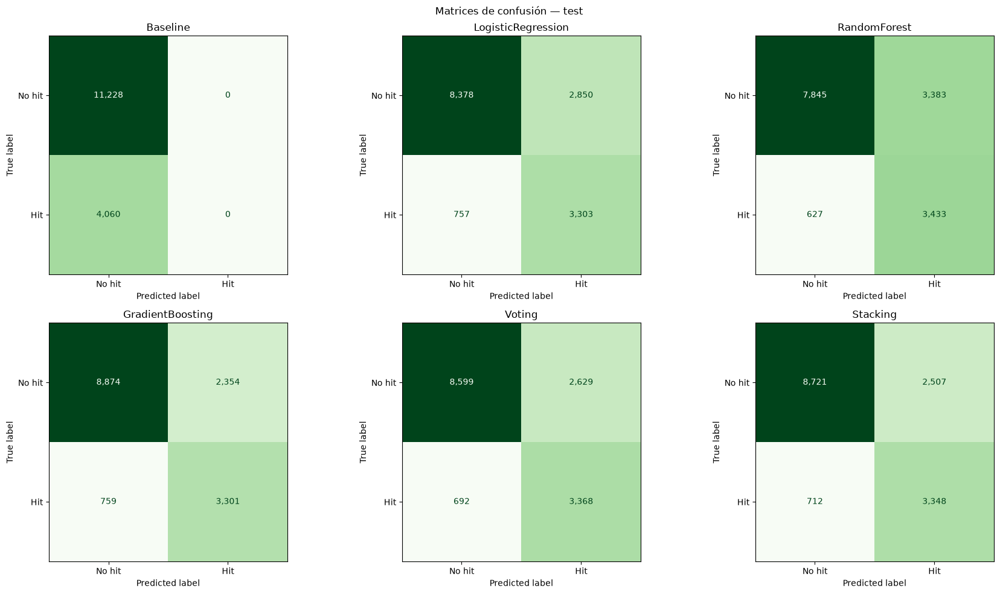
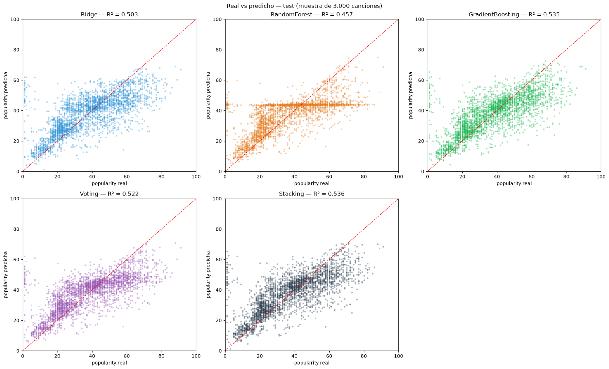
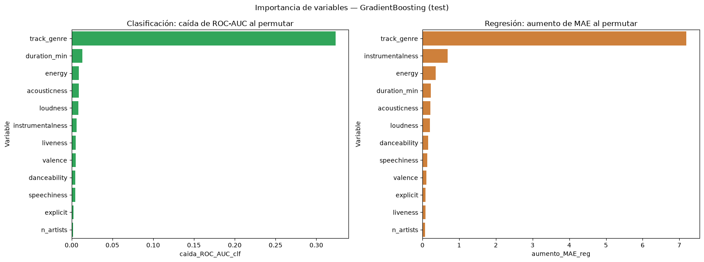
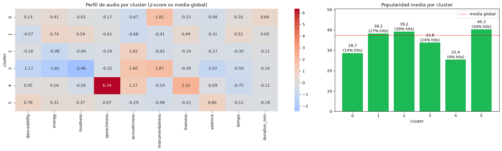
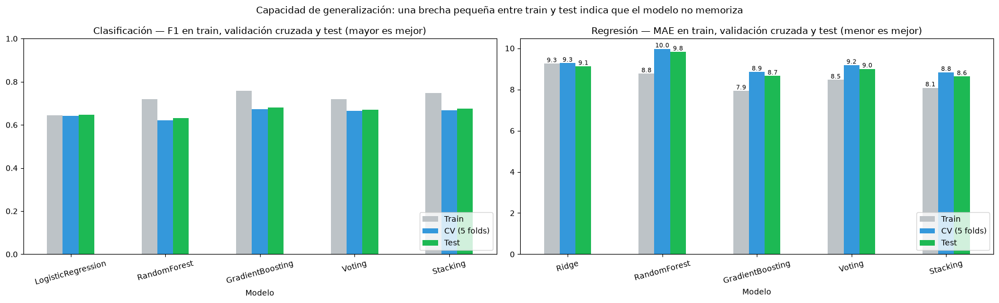
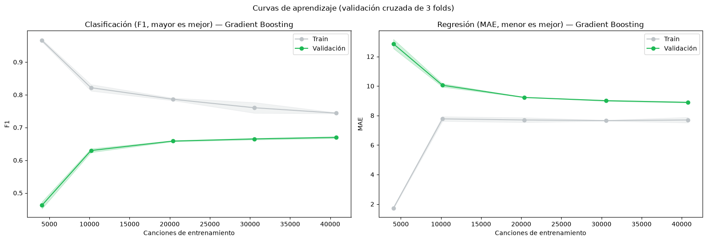

# Inteligencia Musical: Predicción de Popularidad de Canciones en Spotify

[](https://kedro.org)

**Evaluación Final Transversal — MLY1101 Machine Learning · Caso C: Spotify Tracks**

> Informe técnico reproducible del proyecto del semestre. Incorpora, respecto de la Evaluación Parcial N°2: optimización de
> hiperparámetros de **todos** los modelos (no solo Gradient Boosting), **técnicas de ensamble** (Voting y Stacking),
> **análisis de generalización** (train vs validación cruzada vs test y curvas de aprendizaje), análisis cuantitativo de
> **sesgo por género**, marco normativo de privacidad y un notebook que reproduce el proyecto completo.

Proyecto de Machine Learning que predice la popularidad de canciones y segmenta el catálogo musical a partir de su género
y sus características de audio. El proyecto está organizado como un pipeline **Kedro** reproducible, siguiendo la metodología **CRISP-DM**.

---

## Índice

1. [Descripción del problema de negocio](#1-descripción-del-problema-de-negocio)
2. [Objetivos del proyecto](#2-objetivos-del-proyecto)
3. [KPIs](#3-kpis)
4. [Fuentes de datos y herramientas](#4-fuentes-de-datos-y-herramientas)
5. [Metodología CRISP-DM](#5-metodología-crisp-dm)
6. [Análisis exploratorio (EDA)](#6-análisis-exploratorio-eda)
7. [Preparación de datos](#7-preparación-de-datos)
8. [Modelado](#8-modelado)
9. [Optimización de hiperparámetros y técnicas de ensamble](#9-optimización-de-hiperparámetros-y-técnicas-de-ensamble)
10. [Resultados y evaluación](#10-resultados-y-evaluación)
11. [Capacidad de generalización](#11-capacidad-de-generalización)
12. [Selección de la solución óptima](#12-selección-de-la-solución-óptima)
13. [Sesgos, ética y privacidad](#13-sesgos-ética-y-privacidad)
14. [Conclusiones, limitaciones y recomendaciones](#14-conclusiones-limitaciones-y-recomendaciones)
15. [Estructura del proyecto](#15-estructura-del-proyecto)
16. [Cómo reproducir el proyecto](#16-cómo-reproducir-el-proyecto)

---

## 1. Descripción del problema de negocio

Las plataformas de streaming y los sellos discográficos publican miles de canciones cada día, pero tienen un **presupuesto limitado
de promoción**: espacios en playlists editoriales, campañas pagadas y recomendaciones destacadas. Elegir qué canciones promocionar
a ciegas desperdicia ese presupuesto: solo **1 de cada 4 canciones** del catálogo llega a ser realmente popular.

El problema es: **¿se puede anticipar qué canciones serán populares a partir de su género y de sus características musicales,
y qué tipos de música tienen más potencial comercial?**

Responderlo permite:

- Priorizar la inversión de marketing en las canciones con mayor probabilidad de éxito.
- Estimar el rango de popularidad esperado de una canción antes de invertir en ella.
- Entender el catálogo en segmentos de sonido para diseñar playlists y estrategias diferenciadas.

## 2. Objetivos del proyecto

**Objetivo general:** desarrollar modelos de Machine Learning que predigan la popularidad de una canción y segmenten el catálogo
musical, para apoyar la toma de decisiones de promoción.

**Objetivos específicos:**

1. Analizar la calidad y las relaciones de los datos de Spotify para identificar las variables que influyen en la popularidad.
2. Construir y comparar modelos de **clasificación** que predigan si una canción será un *hit* (`popularity >= 50`).
3. Construir y comparar modelos de **regresión** que estimen la popularidad (1–100) de una canción.
4. Aplicar **clustering** (aprendizaje no supervisado) para descubrir segmentos musicales por sonido y evaluar su potencial comercial.
5. Traducir las métricas de los modelos en recomendaciones accionables para el negocio.

## 3. KPIs

### KPIs de negocio

| KPI | Definición | Meta | Resultado |
|---|---|---|---|
| **Tasa de acierto de promoción** | % de hits reales entre el 10% de canciones con mayor probabilidad según el modelo | ≥ 2× la tasa al azar (26.6%) | **85.0%** (3.2× el azar) ✅ |
| **Cobertura de hits** | % de los hits reales que el modelo detecta (Recall) | ≥ 75% | **81.3%** ✅ |
| **Precisión de la estimación** | % de canciones cuya popularidad se estima con un error de ±10 puntos o menos | ≥ 60% | **68.9%** ✅ |
| **Segmentos accionables** | Segmentos de sonido con diferencias claras en tasa de hits | ≥ 4 segmentos interpretables | **6 segmentos**, tasa de hits entre 4% y 30% ✅ |

### KPIs técnicos (métricas de los modelos)

| Tarea | Métrica principal | Meta | Resultado (mejor modelo) |
|---|---|---|---|
| Clasificación | F1-score | ≥ 0.60 | **0.680** |
| Clasificación | ROC-AUC | ≥ 0.80 | **0.884** |
| Regresión | MAE (puntos de popularidad) | < 10 y ≥ 30% mejor que el baseline | **8.65** (−42% vs baseline) |
| Regresión | R² | ≥ 0.40 | **0.535** |
| Clustering | Silhouette con k interpretable | > 0.15 | **0.169** (k = 6) |

> Se usa **F1** y no Accuracy porque las clases están desbalanceadas (73% "no hit"): un modelo que nunca predice hit
> logra 73% de Accuracy con F1 = 0.

## 4. Fuentes de datos y herramientas

### Fuente de datos

| | |
|---|---|
| **Dataset** | Spotify Tracks Dataset (Kaggle), entregado por la asignatura para el Caso C |
| **Verificación** | El `Spotify_Dataset.zip` entregado para la EFT contiene exactamente el mismo archivo que se usó durante el semestre (SHA-256 `b202fa49…77bd`, 20.118.244 bytes) |
| **Archivo** | `data/01_raw/Spotify_Tracks_Dataset.csv` (20 MB) |
| **Tamaño** | 114.000 canciones × 21 columnas |
| **Cobertura** | 114 géneros musicales, exactamente 1.000 canciones por género |

**Diccionario de variables:**

| Variable | Tipo | Descripción |
|---|---|---|
| `track_id`, `artists`, `album_name`, `track_name` | texto | Identificadores de la canción |
| `popularity` | entero 0–100 | Popularidad calculada por Spotify según reproducciones recientes (**target**) |
| `duration_ms` | entero | Duración en milisegundos |
| `explicit` | booleano | Letra explícita |
| `danceability` | 0–1 | Qué tan bailable es (ritmo, estabilidad del pulso) |
| `energy` | 0–1 | Intensidad y actividad percibida |
| `loudness` | dB | Volumen promedio |
| `speechiness` | 0–1 | Presencia de voz hablada |
| `acousticness` | 0–1 | Confianza de que la canción es acústica |
| `instrumentalness` | 0–1 | Probabilidad de que no tenga voz |
| `liveness` | 0–1 | Probabilidad de que sea una grabación en vivo |
| `valence` | 0–1 | Positividad musical (alegre vs triste) |
| `tempo` | BPM | Pulsaciones por minuto |
| `key`, `mode`, `time_signature` | categórica | Tonalidad (0–11), modo mayor/menor, compás |
| `track_genre` | categórica | Género musical (114 valores) |

**Origen y pertinencia:** el dataset fue recopilado desde la **Web API de Spotify** y publicado en Kaggle. Es pertinente para el problema
porque `popularity` es exactamente la señal que usa la plataforma para destacar canciones, y las características de audio
(`danceability`, `energy`, etc.) están disponibles **antes** de que una canción acumule reproducciones, que es el momento en que
el negocio decide qué promocionar. Lo que **no** trae (seguidores del artista, inversión en marketing, fecha de lanzamiento)
se discute como limitación en la sección 14.

**Datos derivados dentro del proyecto** (todos se regeneran desde el CSV original con `kedro run`):

| Capa | Archivo | Contenido |
|---|---|---|
| `01_raw` | `Spotify_Tracks_Dataset.csv` | Original, nunca se modifica |
| `02_intermediate` | `spotify_clean.csv` | Limpio y deduplicado |
| `04_feature` | `spotify_features.csv`, `spotify_encoded.csv` | Features nuevas + One-Hot |
| `05_model_input` | `X_train`, `X_test`, `y_*` | Splits escalados para los modelos supervisados |
| `05_model_input` | `spotify_clustering_input.csv` | 10 features de audio escaladas para clustering |
| `07_model_output` | `cluster_labels.csv` | Segmento asignado a cada canción |

### Herramientas colaborativas y de desarrollo

| Herramienta | Uso en el proyecto | Por qué |
|---|---|---|
| **Git + GitHub** | Repositorio [`Evaluacion2_machine_learning`](https://github.com/felipeangel321/Evaluacion2_machine_learning): historial de cambios, respaldo y punto único de verdad del código, los datos originales y los modelos | Cada integrante clona el mismo proyecto y trabaja sobre la misma versión; los commits documentan *qué* cambió y *por qué*, y permiten volver atrás si un cambio empeora un modelo |
| **Kedro** | Estructura estándar del proyecto, pipelines por etapa y Data Catalog | Separa datos, parámetros y código: cualquier integrante entiende dónde está cada cosa sin explicación previa, y `kedro run` reproduce todo sin pasos manuales. Cada pipeline se puede desarrollar por separado (preparación, modelado, evaluación, clustering) |
| **`conf/base/parameters.yml`** | Todas las decisiones (umbral de hit, columnas, hiperparámetros, espacios de búsqueda) en un solo archivo | Un cambio de criterio se discute y revisa en un lugar, no repartido por el código |
| **Jupyter (kernel Kedro)** | Notebooks de análisis que leen del mismo catálogo que los pipelines | La exploración y la explicación usan exactamente los mismos datos y modelos que el pipeline: no hay copias divergentes |
| **`requirements.txt` + entorno virtual** | Versiones de las librerías | Todos ejecutan con el mismo entorno y obtienen los mismos resultados (`random_state=42` en todo el proyecto) |
| **pytest** | Tests de los nodos de preparación de datos | Si alguien modifica la limpieza o el split, los tests detectan si se rompe una regla (por ejemplo, data leakage) |
| **Kedro-Viz** (opcional) | Diagrama interactivo de los pipelines | Permite revisar el flujo completo en equipo y explicarlo en la presentación |
| **Python: pandas, scikit-learn, matplotlib, seaborn** | Manipulación de datos, modelos y gráficos | Estándar de la industria, documentación abundante y compatible con todos los pasos del proyecto |

## 5. Metodología CRISP-DM

| Fase | Qué se hizo | Dónde |
|---|---|---|
| **1. Comprensión del negocio** | Definición del problema de promoción, objetivos y KPIs | Este README, secciones 1–3 |
| **2. Comprensión de los datos** | EDA: calidad, distribuciones, correlaciones, popularidad por género | `notebooks/01_eda_analisis_exploratorio.ipynb` |
| **3. Preparación de los datos** | Limpieza, deduplicación, feature engineering, encoding, split y escalado | Pipelines `data_cleaning` y `data_transformation` · `notebooks/02_limpieza_transformacion.ipynb` |
| **4. Modelado** | 3 clasificadores y 3 regresores (+ baselines), optimización de hiperparámetros de todos ellos, ensambles Voting y Stacking, K-Means, PCA y DBSCAN | Pipelines `modeling`, `hyperparameter_tuning`, `ensembles`, `unsupervised` · notebooks 03–06 |
| **5. Evaluación** | Métricas en test, validación cruzada de 5 folds, generalización (train vs CV vs test, curvas de aprendizaje), importancia de variables, lift, sesgo por género y selección del modelo final | Pipeline `evaluation` · notebooks 03, 04, 05 y 06 |
| **6. Despliegue** | Proyecto Kedro reproducible con un solo comando (o desde `notebooks/00_reproducir_proyecto.ipynb`), modelos serializados (`.joblib`) e informe técnico | `kedro run` · `models/` · `results/` |

El proceso fue **iterativo**, como plantea CRISP-DM: el EDA obligó a volver a la preparación (deduplicar por nombre + artista,
excluir `popularity = 0`), y la evaluación de la EP2 llevó a volver al modelado (optimizar todos los modelos, agregar ensambles
y medir la generalización).

## 6. Análisis exploratorio (EDA)

Detalle completo en `notebooks/01_eda_analisis_exploratorio.ipynb`.

**Calidad de datos:**

- 1 fila con nulos (sin artista, álbum ni nombre).
- **24.259 `track_id` repetidos**: la misma canción aparece una vez por cada género en que fue listada (hasta 9 veces), con audio idéntico.
- Valores imposibles: 157 canciones con `tempo = 0` y 163 con `time_signature = 0`.
- **14% de canciones con `popularity = 0`**: un pico que rompe la distribución (sin ellos, la popularidad es aproximadamente normal, centrada en ~40).
  No son canciones impopulares: muchas son éxitos mundiales cuya copia en un recopilatorio o playlist no acumula reproducciones (ver hallazgo sobre géneros latinos).

**Hallazgos principales:**

- El dataset está **balanceado por género** (1.000 canciones cada uno), es decir, fue construido artificialmente.
- **Ninguna característica de audio tiene correlación lineal relevante con la popularidad** (todas con |r| < 0.1).
- El **género sí es muy discriminante**: la popularidad media va de ~2 (`iranian`) a ~59 (`pop-film`).
- Hay multicolinealidad entre `energy`, `loudness` (r = 0.76) y `acousticness` (r = −0.73).
- Las relaciones son **no lineales**: por deciles, la popularidad tiene forma de U invertida en `danceability`, `energy` y `valence`
  (los extremos son menos populares), aunque con diferencias de solo ~7 puntos. Por eso la correlación lineal es ~0 y se esperaba
  que los modelos basados en árboles superaran a los lineales.
- **Sesgo de recopilación en géneros latinos:** `latin` tiene mediana de popularidad 0 (59% de ceros) y `reggaeton` mediana 2, aunque Bad Bunny
  fue el artista más escuchado de Spotify en 2020, 2021, 2022 y 2025 ([Spotify Newsroom](https://newsroom.spotify.com/2025-12-03/wrapped-bad-bunny-top-artist-album/)).
  Entre los ceros hay éxitos como *Con Calma* o *MIA*, tomados de recopilatorios (*Clásicos de ahora: Perreo*, *Today's Party Hits*).
  Spotify calcula la popularidad por versión, y para estos géneros el dataset se armó con copias en vez de los originales.

## 7. Preparación de datos

Implementada en los pipelines `data_cleaning` y `data_transformation`, documentada paso a paso en `notebooks/02_limpieza_transformacion.ipynb`.

**Limpieza (114.000 → 76.439 canciones, 67% conservado):**

| Paso | Filas eliminadas | Justificación |
|---|---|---|
| Eliminar `Unnamed: 0` | — | Índice guardado por error en el CSV |
| Nulos | 1 | Impacto nulo; no tiene sentido imputar texto |
| Valores imposibles (`tempo`, `time_signature` o `duration_ms` = 0) | 163 | Errores de medición |
| Duplicados por `track_id` | 24.258 | La misma canción en train y test causaría **data leakage** |
| Duplicados por nombre + artista | 8.385 | Misma canción publicada en varios álbumes (single, álbum, recopilatorio) |
| `popularity = 0` | 4.754 | Artefacto de recopilación: versiones en recopilatorios sin reproducciones propias, no impopularidad real (EDA, sección 8.1) |

**Transformación:**

1. **Feature engineering:** `duration_min`, `n_artists` (número de artistas), `is_collab` (colaboración).
2. **Eliminación de identificadores** de texto libre (`track_id`, `artists`, `album_name`, `track_name`).
3. **One-Hot Encoding** de `track_genre` (114), `key` (12) y `time_signature`, porque son nominales sin orden → 144 features.
4. **Targets:** `popularity` (regresión) e `is_hit = popularity >= 50` (clasificación, 26.6% positivos, ≈ percentil 75).
5. **Split 80/20 estratificado** por `is_hit`: 61.151 canciones de train y 15.288 de test, el mismo split para ambas tareas.
6. **StandardScaler ajustado solo en train** sobre las 11 variables numéricas, para evitar data leakage. Las columnas binarias y One-Hot no se escalan.
7. **Input de clustering:** 10 features de audio escaladas, sin género ni popularidad.

Todos los parámetros (columnas, umbral de hit, tipo de escalador, etc.) están centralizados en `conf/base/parameters.yml`.

## 8. Modelado

### Aprendizaje supervisado

| Familia | Clasificación (`is_hit`) | Regresión (`popularity`) | Justificación |
|---|---|---|---|
| **Baseline** | DummyClassifier (clase mayoritaria) | DummyRegressor (media) | Piso de referencia: cualquier modelo útil debe superarlo |
| **Lineal** | Logistic Regression (L2, `class_weight=balanced`) | Ridge | Interpretable; Ridge maneja la multicolinealidad (energy–loudness r = 0.76) y el One-Hot completo |
| **Bagging** | Random Forest (200 árboles, `class_weight=balanced`) | Random Forest (200 árboles) | Captura relaciones no lineales e interacciones |
| **Boosting** | HistGradientBoosting (`class_weight=balanced`) | HistGradientBoosting | Estado del arte en datos tabulares |

Se eligieron modelos de **familias distintas** a propósito: cometen errores de distinto tipo, y eso es lo que permite evaluar
si combinarlos (sección 9) aporta algo. `class_weight=balanced` compensa el desbalance (27% de hits) dando más peso a los
errores sobre la clase minoritaria.

**Métricas:** F1 (principal) y ROC-AUC en clasificación, porque con 73% de "no hits" un modelo que nunca predice hit logra 73% de
Accuracy con F1 = 0. MAE (principal), RMSE y R² en regresión; el MAE se lee directamente en puntos de popularidad.

**Validación:** todos los modelos se evalúan en test (20% reservado desde el inicio) y con **validación cruzada de 5 folds** sobre train.

### Aprendizaje no supervisado

| Técnica | Uso |
|---|---|
| **K-Means** | Segmentación principal. k se eligió con el método del codo, el silhouette, Davies-Bouldin y la interpretabilidad → **k = 6** |
| **PCA** | Proyección a 2D para visualizar los clusters (PC1 = intensidad, PC2 = ánimo bailable; 44% de la varianza) |
| **DBSCAN** | Contraste por densidad: confirma que no existen grupos naturales bien separados |

## 9. Optimización de hiperparámetros y técnicas de ensamble

Detalle completo en `notebooks/06_optimizacion_ensambles_generalizacion.ipynb`.

### Optimización de hiperparámetros

En la EP2 solo se optimizó Gradient Boosting. Ahora **los 6 modelos** se optimizan con validación cruzada (pipeline
`hyperparameter_tuning`) y cada uno se compara contra su configuración inicial **con los mismos folds**:

| Modelo | Estrategia | Métrica CV | Inicial | Optimizado | Mejora | Mejores hiperparámetros |
|---|---|---|---|---|---|---|
| Logistic Regression | GridSearchCV (5) | F1 | 0.643 | 0.643 | 0.0% | `C=100` (empata con `C=1`) |
| Random Forest | RandomizedSearchCV (8) | F1 | 0.608 | 0.621 | +2.2% | `max_depth=30`, `min_samples_leaf=3`, `max_features=0.2` |
| Gradient Boosting | RandomizedSearchCV (15) | F1 | 0.660 | 0.671 | +1.7% | `max_leaf_nodes=127`, `min_samples_leaf=50`, `learning_rate=0.05`, `max_iter=200` |
| Ridge | GridSearchCV (6) | MAE | 9.28 | 9.28 | +0.1% | `alpha=0.01` |
| Random Forest | RandomizedSearchCV (8) | MAE | 10.84 | 10.00 | +7.8% | `max_depth=30`, `min_samples_leaf=3`, `max_features=0.3` |
| Gradient Boosting | RandomizedSearchCV (15) | MAE | 9.15 | 8.90 | +2.7% | `max_leaf_nodes=127`, `min_samples_leaf=50`, `learning_rate=0.05`, `max_iter=800` |

- **GridSearchCV** para Logistic Regression y Ridge: un solo hiperparámetro, se prueba el espacio completo.
- **RandomizedSearchCV** para Random Forest (27 combinaciones posibles) y Gradient Boosting (432): muestrear al azar encuentra
  configuraciones casi tan buenas como el grid completo a una fracción del costo.
- Se optimiza la métrica principal del negocio (F1 / MAE) con **3 folds sobre train**; el test nunca se usa para elegir.
- **Regla de seguridad:** si la búsqueda no supera a la configuración inicial, se conserva la inicial. No fue necesario en ningún caso.
- **Lectura:** los modelos lineales ya estaban en su techo (la regularización casi no influye con 61 mil canciones y 144 variables).
  Los árboles son los que ganan: Random Forest necesitaba más profundidad y Gradient Boosting, hojas grandes (≥ 50 canciones) con muchas
  hojas por árbol. Las 5 mejores combinaciones de Gradient Boosting tienen F1 entre 0.668 y 0.671: es robusto a la elección exacta.

Resultados en `results/metrics/tuning_summary_clf.csv`, `tuning_summary_reg.csv` y `hyperparameter_results_*.csv`.

### Técnicas de ensamble

| Técnica | Implementación | Cómo combina | Qué reduce |
|---|---|---|---|
| **Bagging** | Random Forest | 200 árboles sobre muestras bootstrap distintas, promediados | Varianza |
| **Boosting** | HistGradientBoosting | Árboles en secuencia, cada uno corrige los errores del anterior | Sesgo |
| **Voting** | `VotingClassifier` (soft) / `VotingRegressor` | Promedio de las predicciones de los 3 modelos optimizados | Errores no correlacionados |
| **Stacking** | `StackingClassifier` / `StackingRegressor` | Un meta-modelo (Logistic Regression / RidgeCV) aprende cuánto confiar en cada modelo, con predicciones out-of-fold | Igual que Voting, con pesos aprendidos |

Voting y Stacking (pipeline `ensembles`) combinan los tres modelos optimizados, de familias distintas: lineal, bagging y boosting.

| Modelo | F1 test | ROC-AUC test | MAE test | R² test |
|---|---|---|---|---|
| **Gradient Boosting** | **0.680** | **0.884** | 8.65 | 0.535 |
| Stacking | 0.675 | 0.884 | **8.63** | **0.536** |
| Voting | 0.670 | 0.879 | 9.00 | 0.522 |
| Mejor modelo simple (LR / Ridge) | 0.647 | 0.861 | 9.12 | 0.503 |

**Resultado:** el aporte del ensamble está en el **boosting**: Gradient Boosting mejora al mejor modelo simple en un 5.1% de F1
(0.647 → 0.680) y un 5.1% de MAE (9.12 → 8.65). Los ensambles de segundo nivel **no agregan valor**:

- **Voting empeora** frente a Gradient Boosting: promedia por igual al mejor modelo con dos más débiles, y lo diluye.
- **Stacking empata:** el meta-modelo asigna casi todo el peso a Gradient Boosting (4.37 contra 1.29 de Random Forest y 0.65 del lineal
  en clasificación; 0.74 contra 0.25 del lineal y 0.05 de Random Forest en regresión). En regresión baja el MAE en 0.025 puntos (0.3%),
  menos que la variación entre folds (±0.05).
- **Por qué:** los modelos se equivocan en las mismas canciones. Sus residuos de regresión tienen una correlación de 0.91 a 0.95 y
  el 85% de los errores de Gradient Boosting también los comete Logistic Regression. Un ensamble solo corrige errores que no se comparten;
  los que quedan dependen de variables que no están en el dataset (artista, marketing).

Pesos del meta-modelo en `results/metrics/stacking_weights.csv`.

## 10. Resultados y evaluación

### Clasificación — ¿será un hit?

| Modelo | Accuracy | Precision | Recall | F1 | ROC-AUC |
|---|---|---|---|---|---|
| Baseline | 0.734 | 0.000 | 0.000 | 0.000 | 0.500 |
| Logistic Regression | 0.764 | 0.537 | 0.814 | 0.647 | 0.861 |
| Random Forest | 0.738 | 0.504 | 0.846 | 0.631 | 0.857 |
| **Gradient Boosting** | **0.796** | **0.584** | 0.813 | **0.680** | **0.884** |
| Voting | 0.783 | 0.562 | 0.830 | 0.670 | 0.879 |
| Stacking | 0.789 | 0.572 | 0.825 | 0.675 | 0.884 |

Validación cruzada (F1): Gradient Boosting 0.673 ± 0.004 · Stacking 0.669 ± 0.004 · Voting 0.664 ± 0.005 ·
Logistic Regression 0.643 ± 0.003 · Random Forest 0.621 ± 0.006.



Sobre 15.288 canciones de test (4.060 hits), Gradient Boosting detecta 3.301 hits (Recall 81%) con 2.354 falsos positivos:
~500 menos que Logistic Regression, ~1.000 menos que Random Forest y ~150 menos que Stacking.

**Lift para el negocio:** si se promociona solo el 10% de canciones con mayor probabilidad según Gradient Boosting, el **85% son hits reales**,
frente al 26.6% de elegir al azar (3.2×). Con el 5% superior, la precisión sube a 91%.

### Regresión — ¿cuánta popularidad tendrá?

| Modelo | MAE | RMSE | R² |
|---|---|---|---|
| Baseline | 14.88 | 17.79 | 0.000 |
| Ridge | 9.12 | 12.55 | 0.503 |
| Random Forest | 9.82 | 13.11 | 0.457 |
| **Gradient Boosting** | 8.65 | 12.13 | 0.535 |
| Voting | 9.00 | 12.30 | 0.522 |
| Stacking | **8.63** | **12.12** | **0.536** |

Validación cruzada (MAE): Stacking 8.83 ± 0.05 · Gradient Boosting 8.85 ± 0.05 · Voting 9.18 ± 0.05 · Ridge 9.28 ± 0.05 ·
Random Forest 9.97 ± 0.06.

**¿Se cumplió la hipótesis del EDA?** Solo en parte: Gradient Boosting supera a los modelos lineales en ambas tareas, pero Random Forest
queda por debajo de Logistic Regression y de Ridge, incluso después de optimizarlo. Una explicación probable es que el género, la variable
más importante, está repartido en 114 columnas One-Hot: cada división de un árbol separa un solo género del resto, mientras Boosting y los
modelos lineales acumulan su efecto de forma aditiva.



El error es menor en el rango medio de popularidad (20–60). El modelo **subestima las canciones muy populares (> 60)**:
con las variables disponibles no puede anticipar los éxitos masivos, que dependen del artista, el marketing y la viralidad.
El 68.9% de las canciones se estima a ±10 puntos y el error mediano es de 6.1 puntos.

### ¿Qué hace que una canción sea popular?



- El **género** es, por lejos, la variable más importante: al desordenarlo, el ROC-AUC cae de 0.88 a ~0.56 y el MAE sube 7.2 puntos.
- Géneros con más probabilidad de hit: pop-film, hip-hop, pop, electro, chill, EDM, house, metal y k-pop.
- Con el género fijo, ser **explícita**, una **colaboración** y tener **más volumen** aumentan la probabilidad de hit. Ser **instrumental**,
  **hablada**, **en vivo** o **larga** la reduce.

### Segmentación musical (K-Means, k = 6)



| Segmento | % del catálogo | Perfil | Popularidad media | % hits |
|---|---|---|---|---|
| **Bailable y alegre** | 32% | Alta danceability y valence (salsa, forró, dancehall) | 40.3 | 30% |
| **Acústica melódica** | 21% | Acústica, baja energía, con voz (tango, honky-tonk, cantopop) | 39.2 | 30% |
| **Intensa / rock-metal** | 26% | Máxima energía y volumen (metal, hardstyle) | 38.2 | 27% |
| **Ambiental / relajación** | 7% | Silenciosa, acústica e instrumental (new-age, sleep, piano) | 33.8 | 24% |
| **Electrónica instrumental** | 12% | Energética, sin voz, larga (techno, house, IDM) | 28.7 | 14% |
| **Hablada / en vivo** | 1% | Voz hablada y público (comedia, musicales) | 25.4 | 4% |

La popularidad **no se usó** para formar los clusters, y aun así difiere claramente entre segmentos. DBSCAN no encontró grupos
densos separados (según `eps`, más del 50% queda como ruido o casi todo cae en un solo cluster): la música es un continuo, y K-Means es
adecuado para *particionarlo* en segmentos accionables.

## 11. Capacidad de generalización

Un modelo útil rinde igual con canciones que nunca vio. Para cada modelo se compara el desempeño en **train**, en **validación
cruzada de 5 folds** y en **test** (pipeline `evaluation`, `results/metrics/generalization_*.csv`):

| Modelo | F1 train | F1 CV | F1 test | MAE train | MAE CV | MAE test | Diagnóstico (clasif. / regr.) |
|---|---|---|---|---|---|---|---|
| Logistic Regression / Ridge | 0.645 | 0.643 | 0.647 | 9.25 | 9.28 | 9.12 | generaliza bien / generaliza bien |
| Random Forest | 0.718 | 0.621 | 0.631 | 8.76 | 9.97 | 9.82 | sobreajuste leve / sobreajuste leve |
| **Gradient Boosting** | 0.758 | 0.673 | 0.680 | 7.93 | 8.85 | 8.65 | sobreajuste leve / generaliza bien |
| Voting | 0.718 | 0.664 | 0.670 | 8.46 | 9.18 | 9.00 | generaliza bien / generaliza bien |
| Stacking | 0.748 | 0.669 | 0.675 | 8.08 | 8.83 | 8.63 | generaliza bien / generaliza bien |

Diagnóstico según la brecha relativa entre train y test: < 10% generaliza bien, 10–25% sobreajuste leve, > 25% sobreajuste.



- **CV ≈ test en todos los modelos** (Gradient Boosting: F1 0.673 vs 0.680, MAE 8.85 vs 8.65) y la desviación entre folds es mínima
  (≤ 0.006 en F1, ≤ 0.06 en MAE): el desempeño no depende de cómo se partieron los datos.
- Los modelos de árboles tienen una **brecha leve** entre train y test (Gradient Boosting: 10% en F1, 8% en MAE). Es un sobreajuste
  controlado: aun así son los mejores en test, y el test no se usó para ninguna decisión.



**Curvas de aprendizaje (Gradient Boosting):** la curva de validación sube y la de train baja hasta casi juntarse. El F1 de validación
pasa de 0.46 con 4 mil canciones a 0.670 con 41 mil, todavía subiendo levemente; el MAE baja de 12.9 a 8.9. Más canciones ayudarían
poco: el techo lo ponen las variables que faltan, no la cantidad de datos.

## 12. Selección de la solución óptima

**Gradient Boosting** es la solución elegida en ambas tareas:

| Criterio | Gradient Boosting | Stacking (el más cercano) |
|---|---|---|
| F1 / ROC-AUC (clasificación, test) | **0.680** / 0.884 | 0.675 / 0.884 |
| MAE / R² (regresión, test) | 8.65 / 0.535 | 8.63 / 0.536 |
| Estabilidad (desv. CV de F1 / MAE) | 0.004 / 0.047 | 0.004 / 0.048 |
| Tamaño del modelo (clasificación / regresión) | **2.9 / 2.7 MB** | 15.2 / 30.5 MB |
| Interpretación | Directa (importancia por permutación) | 3 modelos + un meta-modelo |

- En clasificación gana en F1 y empata en ROC-AUC. En regresión empata técnicamente con Stacking (0.03 puntos de MAE, menos que la
  variación entre folds); ante un empate se elige el modelo **más simple**: 5 a 11 veces más liviano, más rápido y más fácil de explicar.
- Generaliza (CV ≈ test), supera ampliamente al baseline (−42% de MAE; F1 0.680 frente a 0) y cumple todos los KPIs (sección 3).
- **Para decidir qué promocionar se recomienda el clasificador**, porque la regresión subestima los éxitos masivos; el regresor sirve
  para estimar el rango de popularidad (bajo, medio, alto).
- **Logistic Regression** queda como alternativa interpretable (F1 0.647): sus coeficientes muestran la dirección de cada efecto.

## 13. Sesgos, ética y privacidad

### Sesgos

- **Sesgo de recopilación en géneros latinos (medido):** el grupo latino urbano (`latin`, `latino`, `reggaeton`, `reggae`; 148 canciones
  en test) tiene un **MAE de 19.7 puntos, 2.3 veces el del resto (8.5)**, y el modelo subestima su popularidad en 4.6 puntos en promedio.
  El sesgo de los datos (copias de recopilatorios en vez de originales, ver EDA) pasa al modelo. Análisis en el notebook 06, sección 4.
- **Sesgo de muestreo:** exactamente 1.000 canciones por género; no representa la distribución real del catálogo de Spotify.
- **Sesgo de plataforma:** la popularidad de Spotify refleja a su base de usuarios (mercado occidental y comercial), no el valor artístico.

### Consideraciones éticas

- **Riesgo de homogeneización cultural:** usar estos modelos para decidir qué promocionar refuerza a los géneros que ya son populares
  y reduce la visibilidad de géneros de nicho, regionales o de artistas emergentes (por ejemplo tango, música iraní o IDM), lo que crea un ciclo de
  retroalimentación ("lo popular se vuelve más popular").
- **Uso recomendado:** como herramienta de **apoyo** a la decisión, no como reemplazo del criterio editorial, reservando cuotas
  de promoción para la diversidad musical y para artistas nuevos. Las predicciones para música urbana latina requieren revisión humana.
- **Transparencia:** la importancia por permutación y los coeficientes de Logistic Regression permiten explicar por qué el modelo
  recomienda una canción (principalmente por su género).

### Privacidad y uso de los datos

- **Sin datos de usuarios:** el dataset contiene metadatos de canciones, no datos de oyentes ni de reproducciones individuales.
- **Datos de personas públicas:** los nombres de artistas son datos personales de personas naturales, aunque públicos. Aplicando el
  principio de **minimización** (Ley 19.628 sobre protección de la vida privada y Ley 21.719 de protección de datos personales de Chile,
  que entra en plena vigencia en diciembre de 2026), el modelo **no usa** nombres de artistas, álbumes ni canciones: se eliminan antes del
  modelado y no influyen en ninguna predicción.
- **Términos de uso:** los datos provienen de la Web API de Spotify, cuyos términos para desarrolladores restringen el uso comercial y el
  entrenamiento de modelos de Machine Learning con su contenido. Este proyecto es **académico**; un uso comercial requeriría un acuerdo
  con Spotify o datos propios del sello o la plataforma.

## 14. Conclusiones, limitaciones y recomendaciones

### Conclusiones

1. **Es posible anticipar qué canciones serán populares:** Gradient Boosting detecta el 81% de los hits y, promocionando el 10% con mayor
   probabilidad, el 85% son hits reales (3.2× el azar). Los 4 KPIs de negocio y los 5 técnicos se cumplen.
2. **El género explica la popularidad; el sonido, poco:** al desordenar el género el modelo cae casi al azar (ROC-AUC 0.56).
3. **Optimizar mejora los modelos de árboles** (Random Forest −7.8% de MAE), mientras los lineales ya estaban en su techo.
4. **Combinar modelos no aporta** cuando todos se equivocan en las mismas canciones: el boosting es el ensamble que sí agrega valor.
5. **Los modelos generalizan:** CV ≈ test y desviaciones mínimas entre folds.
6. **El catálogo se divide en 6 segmentos de sonido** con tasas de hit entre 4% y 30%, sin haber usado la popularidad para formarlos.

### Limitaciones

- Faltan variables decisivas para la popularidad: seguidores del artista, inversión en marketing y fecha de lanzamiento.
  Esto explica que el R² se quede en 0.53 y que las curvas de aprendizaje se estabilicen.
- El dataset tiene exactamente 1.000 canciones por género (muestreo artificial).
- La popularidad es una foto en el tiempo: cambia con las reproducciones recientes.
- La deduplicación conserva un solo género por canción, aunque algunas canciones pertenecen a varios.
- **Sesgo en géneros latinos:** la exclusión de `popularity = 0` elimina 265 éxitos latinos sin versión original en el dataset, y el modelo
  tiene 2.3 veces más error en ese grupo: sus predicciones para música urbana latina no son confiables.
- El modelo no se evaluó con canciones sin datos de reproducción (`popularity = 0`).

### Recomendaciones de negocio

1. **Usar el clasificador para priorizar la promoción:** concentrar el presupuesto en el 10% de canciones con mayor probabilidad
   de hit multiplica por 3,2 la tasa de acierto frente a elegir al azar (85% vs 26,6%).
2. **Ajustar el umbral según la estrategia:** con presupuesto acotado (playlists editoriales), umbral alto para priorizar Precision.
   Para descubrimiento amplio, umbral 0.5, que detecta el 81% de los hits.
3. **Priorizar los segmentos "Bailable y alegre" y "Acústica melódica"**, que suman el 53% del catálogo y tienen la mayor tasa de hits (30%).
4. **Llevar la "Electrónica instrumental" y lo "Ambiental" a playlists de nicho o funcionales** (concentración, dormir, clubes) en vez de campañas masivas.
5. **Separar el contenido hablado** (comedia, musicales) del catálogo musical en las recomendaciones: casi no genera hits (4%).
6. **Usar el segmento de sonido como señal de recomendación**: canciones de distinto género pero del mismo segmento son buenas candidatas
   para "si te gustó X, escucha Y".
7. **Reservar cuotas de promoción** para géneros de nicho y artistas nuevos, y revisar a mano las predicciones de música urbana latina.

**Mejoras futuras:** incorporar variables del artista (seguidores, lanzamientos previos) y la fecha de lanzamiento, que es donde está el
techo del modelo; unificar `latin`, `latino`, `reggaeton` y `reggae` en una categoría `latin_urbano` (p. ej. 804 de las 1.000 canciones
de `reggae` también están en `reggaeton`) y reconstruirla con las versiones originales de cada canción.

## 15. Estructura del proyecto

```
evaluacion2-machine/
├── conf/base/
│   ├── catalog.yml              # Datasets, modelos, métricas y gráficos (Kedro Data Catalog)
│   └── parameters.yml           # Todas las decisiones de limpieza, features y modelos
├── data/
│   ├── 01_raw/                  # Spotify_Tracks_Dataset.csv (original)
│   ├── 02_intermediate/         # Datos limpios           ┐
│   ├── 04_feature/              # Features + encoding     │ generados por
│   ├── 05_model_input/          # Splits train/test       │ `kedro run`
│   ├── 06_models/               # Escalador ajustado      │
│   └── 07_model_output/         # Etiquetas de cluster    ┘
├── models/trained_models/       # Modelos entrenados (.joblib)
├── notebooks/
│   ├── 00_reproducir_proyecto.ipynb            # Ejecuta el pipeline completo desde Jupyter
│   ├── 01_eda_analisis_exploratorio.ipynb
│   ├── 02_limpieza_transformacion.ipynb
│   ├── 03_modelos_clasificacion.ipynb
│   ├── 04_modelos_regresion.ipynb
│   ├── 05_no_supervisado_clustering.ipynb
│   └── 06_optimizacion_ensambles_generalizacion.ipynb
├── results/                     # (cumple el rol de images/ + métricas)
│   ├── metrics/                 # Métricas en CSV (test, CV, optimización, ensambles, generalización, clusters)
│   └── plots/                   # Gráficos usados en este informe
├── src/evaluacion2_machine/pipelines/
│   ├── data_cleaning/           # Nulos, valores imposibles, duplicados, popularity = 0
│   ├── data_transformation/     # Features, encoding, targets, split, escalado
│   ├── modeling/                # Baselines y configuración inicial de Logistic Regression / Ridge y Random Forest
│   ├── hyperparameter_tuning/   # GridSearchCV / RandomizedSearchCV de los 6 modelos
│   ├── ensembles/               # Voting y Stacking
│   ├── evaluation/              # Métricas, validación cruzada, generalización, importancia de variables
│   └── unsupervised/            # K-Means, PCA, perfiles de clusters, DBSCAN
├── tests/                       # Tests de preparación de datos, optimización y ensambles (pytest)
├── requirements.txt
└── README.md                    # Este informe
```

## 16. Cómo reproducir el proyecto

**Requisitos:** Python 3.11 o superior (probado con Python 3.13, Kedro 1.7.0 y scikit-learn 1.9.1).

```bash
# 1. Clonar el repositorio
git clone https://github.com/felipeangel321/Evaluacion2_machine_learning.git
cd Evaluacion2_machine_learning

# 2. Crear el entorno e instalar dependencias
python -m venv .venv
.venv\Scripts\activate          # Windows  (Linux/Mac: source .venv/bin/activate)
pip install -r requirements.txt
pip install -e .

# 3. Ejecutar el proyecto completo (~45 min; la mayor parte es la optimización y la validación cruzada de los ensambles)
kedro run
```

**Pipelines disponibles** (se pueden ejecutar por separado con `kedro run --pipeline <nombre>`):

| Pipeline | Contenido |
|---|---|
| `data_preprocessing` | `data_cleaning` + `data_transformation` |
| `training` | `modeling` (baselines y configuración inicial) + `hyperparameter_tuning` (optimización de los 6 modelos) |
| `ensembles` | Voting y Stacking a partir de los modelos optimizados (requiere `training`) |
| `evaluation` | Métricas, validación cruzada, generalización, gráficos e importancia de variables (requiere `training` y `ensembles`) |
| `supervised` | `training` + `ensembles` + `evaluation` |
| `unsupervised` | K-Means, PCA, perfiles de clusters y DBSCAN |

**Notebooks:** abrir con el kernel de Kedro, para que `catalog` esté disponible:

```bash
kedro jupyter lab
```

`00_reproducir_proyecto.ipynb` ejecuta todo el pipeline desde el notebook (equivale a `kedro run`). Luego, los notebooks
01 → 06 explican cada etapa; los notebooks 03 a 06 cargan los modelos y resultados generados por el pipeline.

**Tests** (14 tests: preparación de datos, optimización, ensambles y diagnóstico de generalización):

```bash
pytest
```

**Visualizar los pipelines** (opcional):

```bash
pip install kedro-viz
kedro viz
```
