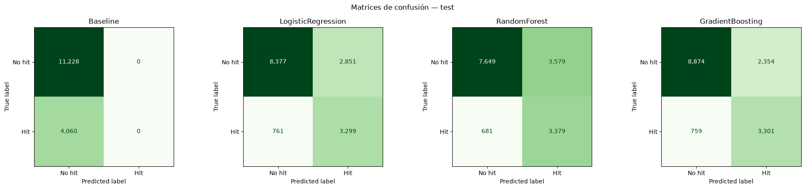
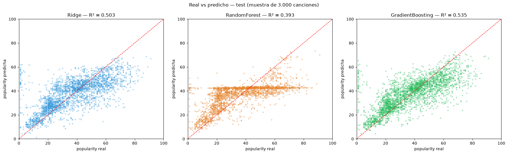
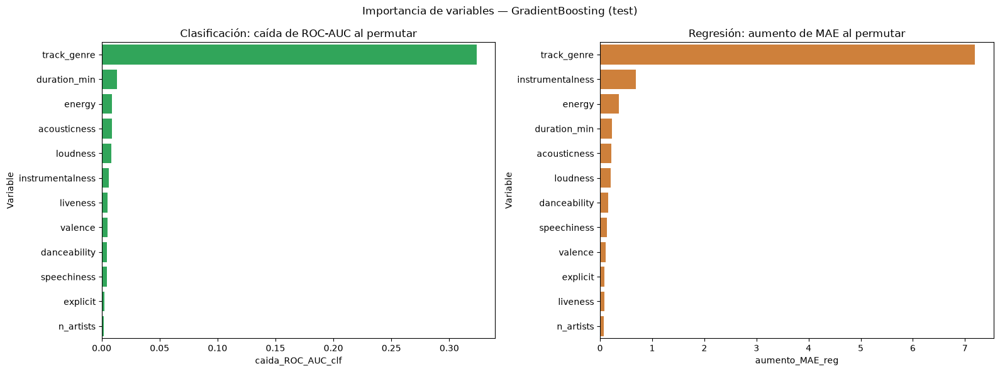
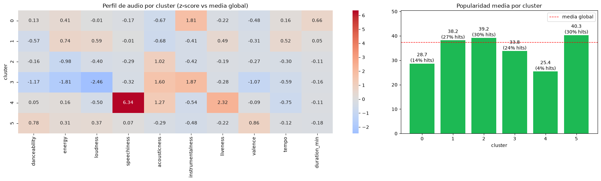

# Inteligencia Musical: Predicción de Popularidad de Canciones en Spotify

[](https://kedro.org)

**Evaluación Parcial N°2 — MLY1101 Machine Learning · Caso C: Spotify Tracks**

Proyecto de Machine Learning que predice la popularidad de canciones y segmenta el catálogo musical a partir de su género
y sus características de audio. El proyecto está organizado como un pipeline **Kedro** reproducible, siguiendo la metodología **CRISP-DM**.

---

## Índice

1. [Descripción del problema de negocio](#1-descripción-del-problema-de-negocio)
2. [Objetivos del proyecto](#2-objetivos-del-proyecto)
3. [KPIs](#3-kpis)
4. [Fuente de datos](#4-fuente-de-datos)
5. [Metodología CRISP-DM](#5-metodología-crisp-dm)
6. [Análisis exploratorio (EDA)](#6-análisis-exploratorio-eda)
7. [Preparación de datos](#7-preparación-de-datos)
8. [Modelado](#8-modelado)
9. [Resultados y evaluación](#9-resultados-y-evaluación)
10. [Recomendaciones de negocio](#10-recomendaciones-de-negocio)
11. [Impacto ético y limitaciones](#11-impacto-ético-y-limitaciones)
12. [Estructura del proyecto](#12-estructura-del-proyecto)
13. [Cómo reproducir el proyecto](#13-cómo-reproducir-el-proyecto)

---

## 1. Descripción del problema de negocio

Las plataformas de streaming y los sellos discográficos publican miles de canciones cada día, pero tienen un **presupuesto limitado
de promoción**: espacios en playlists editoriales, campañas pagadas y recomendaciones destacadas. Elegir qué canciones promocionar
a ciegas desperdicia ese presupuesto: solo **1 de cada 4 canciones** del catálogo llega a ser realmente popular.

El problema es: **¿se puede anticipar qué canciones serán populares a partir de su género y de sus características musicales,
y qué tipos de música tienen más potencial comercial?**

Responderlo permite:

- Priorizar la inversión de marketing en las canciones con mayor probabilidad de éxito.
- Estimar el rango de popularidad esperado de una canción antes de invertir en ella.
- Entender el catálogo en segmentos de sonido para diseñar playlists y estrategias diferenciadas.

## 2. Objetivos del proyecto

**Objetivo general:** desarrollar modelos de Machine Learning que predigan la popularidad de una canción y segmenten el catálogo
musical, para apoyar la toma de decisiones de promoción.

**Objetivos específicos:**

1. Analizar la calidad y las relaciones de los datos de Spotify para identificar las variables que influyen en la popularidad.
2. Construir y comparar modelos de **clasificación** que predigan si una canción será un *hit* (`popularity >= 50`).
3. Construir y comparar modelos de **regresión** que estimen la popularidad (1–100) de una canción.
4. Aplicar **clustering** (aprendizaje no supervisado) para descubrir segmentos musicales por sonido y evaluar su potencial comercial.
5. Traducir las métricas de los modelos en recomendaciones accionables para el negocio.

## 3. KPIs

### KPIs de negocio

| KPI | Definición | Meta | Resultado |
|---|---|---|---|
| **Tasa de acierto de promoción** | % de hits reales entre el 10% de canciones con mayor probabilidad según el modelo | ≥ 2× la tasa al azar (26.6%) | **85.0%** (3.2× el azar) ✅ |
| **Cobertura de hits** | % de los hits reales que el modelo detecta (Recall) | ≥ 75% | **81.3%** ✅ |
| **Precisión de la estimación** | % de canciones cuya popularidad se estima con un error de ±10 puntos o menos | ≥ 60% | **68.9%** ✅ |
| **Segmentos accionables** | Segmentos de sonido con diferencias claras en tasa de hits | ≥ 4 segmentos interpretables | **6 segmentos**, tasa de hits entre 4% y 30% ✅ |

### KPIs técnicos (métricas de los modelos)

| Tarea | Métrica principal | Meta | Resultado (mejor modelo) |
|---|---|---|---|
| Clasificación | F1-score | ≥ 0.60 | **0.680** |
| Clasificación | ROC-AUC | ≥ 0.80 | **0.884** |
| Regresión | MAE (puntos de popularidad) | < 10 y ≥ 30% mejor que el baseline | **8.65** (−42% vs baseline) |
| Regresión | R² | ≥ 0.40 | **0.535** |
| Clustering | Silhouette con k interpretable | > 0.15 | **0.169** (k = 6) |

> Se usa **F1** y no Accuracy porque las clases están desbalanceadas (73% "no hit"): un modelo que nunca predice hit
> logra 73% de Accuracy con F1 = 0.

## 4. Fuente de datos

| | |
|---|---|
| **Dataset** | Spotify Tracks Dataset (Kaggle), entregado por la asignatura para el Caso C |
| **Archivo** | `data/01_raw/Spotify_Tracks_Dataset.csv` (20 MB) |
| **Tamaño** | 114.000 canciones × 21 columnas |
| **Cobertura** | 114 géneros musicales, exactamente 1.000 canciones por género |

**Diccionario de variables:**

| Variable | Tipo | Descripción |
|---|---|---|
| `track_id`, `artists`, `album_name`, `track_name` | texto | Identificadores de la canción |
| `popularity` | entero 0–100 | Popularidad calculada por Spotify según reproducciones recientes (**target**) |
| `duration_ms` | entero | Duración en milisegundos |
| `explicit` | booleano | Letra explícita |
| `danceability` | 0–1 | Qué tan bailable es (ritmo, estabilidad del pulso) |
| `energy` | 0–1 | Intensidad y actividad percibida |
| `loudness` | dB | Volumen promedio |
| `speechiness` | 0–1 | Presencia de voz hablada |
| `acousticness` | 0–1 | Confianza de que la canción es acústica |
| `instrumentalness` | 0–1 | Probabilidad de que no tenga voz |
| `liveness` | 0–1 | Probabilidad de que sea una grabación en vivo |
| `valence` | 0–1 | Positividad musical (alegre vs triste) |
| `tempo` | BPM | Pulsaciones por minuto |
| `key`, `mode`, `time_signature` | categórica | Tonalidad (0–11), modo mayor/menor, compás |
| `track_genre` | categórica | Género musical (114 valores) |

## 5. Metodología CRISP-DM

| Fase | Qué se hizo | Dónde |
|---|---|---|
| **1. Comprensión del negocio** | Definición del problema de promoción, objetivos y KPIs | Este README, secciones 1–3 |
| **2. Comprensión de los datos** | EDA: calidad, distribuciones, correlaciones, popularidad por género | `notebooks/01_eda_analisis_exploratorio.ipynb` |
| **3. Preparación de los datos** | Limpieza, deduplicación, feature engineering, encoding, split y escalado | Pipelines `data_cleaning` y `data_transformation` · `notebooks/02_limpieza_transformacion.ipynb` |
| **4. Modelado** | 3 clasificadores, 3 regresores (+ baselines), optimización de hiperparámetros, K-Means, PCA y DBSCAN | Pipelines `modeling`, `hyperparameter_tuning`, `unsupervised` |
| **5. Evaluación** | Métricas en test, validación cruzada de 5 folds, importancia de variables, análisis de umbral y lift | Pipeline `evaluation` · notebooks 03, 04 y 05 |
| **6. Despliegue** | Proyecto Kedro reproducible con un solo comando, modelos serializados (`.joblib`) e informe técnico | `kedro run` · `models/` · `results/` |

## 6. Análisis exploratorio (EDA)

Detalle completo en `notebooks/01_eda_analisis_exploratorio.ipynb`.

**Calidad de datos:**

- 1 fila con nulos (sin artista, álbum ni nombre).
- **24.259 `track_id` repetidos**: la misma canción aparece una vez por cada género en que fue listada (hasta 9 veces), con audio idéntico.
- Valores imposibles: 157 canciones con `tempo = 0` y 163 con `time_signature = 0`.
- **14% de canciones con `popularity = 0`**: un pico que rompe la distribución (sin ellos, la popularidad es aproximadamente normal, centrada en ~40).
  No son canciones impopulares: muchas son éxitos mundiales cuya copia en un recopilatorio o playlist no acumula reproducciones (ver hallazgo sobre géneros latinos).

**Hallazgos principales:**

- El dataset está **balanceado por género** (1.000 canciones cada uno), es decir, fue construido artificialmente.
- **Ninguna característica de audio tiene correlación lineal relevante con la popularidad** (todas con |r| < 0.1).
- El **género sí es muy discriminante**: la popularidad media va de ~2 (`iranian`) a ~59 (`pop-film`).
- Hay multicolinealidad entre `energy`, `loudness` (r = 0.76) y `acousticness` (r = −0.73).
- Las relaciones son no lineales, por lo que se esperaba que los modelos basados en árboles superaran a los lineales.
- **Sesgo de recopilación en géneros latinos:** `latin` tiene mediana de popularidad 0 (59% de ceros) y `reggaeton` mediana 2, aunque Bad Bunny
  fue el artista más escuchado de Spotify en 2020, 2021, 2022 y 2025 ([Spotify Newsroom](https://newsroom.spotify.com/2025-12-03/wrapped-bad-bunny-top-artist-album/)).
  Entre los ceros hay éxitos como *Con Calma* o *MIA*, tomados de recopilatorios (*Clásicos de ahora: Perreo*, *Today's Party Hits*).
  Spotify calcula la popularidad por versión, y para estos géneros el dataset se armó con copias en vez de los originales.

## 7. Preparación de datos

Implementada en los pipelines `data_cleaning` y `data_transformation`, documentada paso a paso en `notebooks/02_limpieza_transformacion.ipynb`.

**Limpieza (114.000 → 76.439 canciones, 67% conservado):**

| Paso | Filas eliminadas | Justificación |
|---|---|---|
| Eliminar `Unnamed: 0` | — | Índice guardado por error en el CSV |
| Nulos | 1 | Impacto nulo; no tiene sentido imputar texto |
| Valores imposibles (`tempo`, `time_signature` o `duration_ms` = 0) | 163 | Errores de medición |
| Duplicados por `track_id` | 24.258 | La misma canción en train y test causaría **data leakage** |
| Duplicados por nombre + artista | 8.385 | Misma canción publicada en varios álbumes (single, álbum, recopilatorio) |
| `popularity = 0` | 4.754 | Artefacto de recopilación: versiones en recopilatorios sin reproducciones propias, no impopularidad real (EDA, sección 8.1) |

**Transformación:**

1. **Feature engineering:** `duration_min`, `n_artists` (número de artistas), `is_collab` (colaboración).
2. **Eliminación de identificadores** de texto libre (`track_id`, `artists`, `album_name`, `track_name`).
3. **One-Hot Encoding** de `track_genre` (114), `key` (12) y `time_signature`, porque son nominales sin orden → 144 features.
4. **Targets:** `popularity` (regresión) e `is_hit = popularity >= 50` (clasificación, 26.6% positivos, ≈ percentil 75).
5. **Split 80/20 estratificado** por `is_hit`: 61.151 canciones de train y 15.288 de test, el mismo split para ambas tareas.
6. **StandardScaler ajustado solo en train** sobre las 11 variables numéricas, para evitar data leakage. Las columnas binarias y One-Hot no se escalan.
7. **Input de clustering:** 10 features de audio escaladas, sin género ni popularidad.

Todos los parámetros (columnas, umbral de hit, tipo de escalador, etc.) están centralizados en `conf/base/parameters.yml`.

## 8. Modelado

### Aprendizaje supervisado

| Modelo | Clasificación (`is_hit`) | Regresión (`popularity`) | Justificación |
|---|---|---|---|
| **Baseline** | DummyClassifier (clase mayoritaria) | DummyRegressor (media) | Piso de referencia |
| **Lineal** | Logistic Regression (L2, `class_weight=balanced`) | Ridge (`alpha=1.0`) | Interpretable; Ridge maneja la multicolinealidad y el One-Hot completo |
| **Random Forest** | 200 árboles, `max_depth=20`, `min_samples_leaf=5`, `class_weight=balanced` | 200 árboles, `max_depth=20`, `max_features=0.3` | Captura relaciones no lineales e interacciones |
| **Gradient Boosting** | HistGradientBoosting, `class_weight=balanced` | HistGradientBoosting | Estado del arte en datos tabulares |

**Optimización de hiperparámetros:** Gradient Boosting se ajustó con **RandomizedSearchCV** (15 combinaciones × 3 folds),
optimizando F1 en clasificación y MAE en regresión, sobre `learning_rate`, `max_iter`, `max_leaf_nodes`, `min_samples_leaf`
y `l2_regularization`. Mejor configuración en ambos casos: `max_leaf_nodes=127`, `min_samples_leaf=50`, `learning_rate=0.05`.

**Validación:** todos los modelos se evalúan en test y con **validación cruzada de 5 folds** sobre train.

### Aprendizaje no supervisado

| Técnica | Uso |
|---|---|
| **K-Means** | Segmentación principal. k se eligió con el método del codo, el silhouette, Davies-Bouldin y la interpretabilidad → **k = 6** |
| **PCA** | Proyección a 2D para visualizar los clusters (PC1 = intensidad, PC2 = ánimo bailable; 44% de la varianza) |
| **DBSCAN** | Contraste por densidad: confirma que no existen grupos naturales bien separados |

## 9. Resultados y evaluación

### Clasificación — ¿será un hit?

| Modelo | Accuracy | Precision | Recall | F1 | ROC-AUC |
|---|---|---|---|---|---|
| Baseline | 0.734 | 0.000 | 0.000 | 0.000 | 0.500 |
| Logistic Regression | 0.764 | 0.536 | 0.813 | 0.646 | 0.861 |
| Random Forest | 0.721 | 0.486 | 0.832 | 0.613 | 0.846 |
| **Gradient Boosting** | **0.796** | **0.584** | 0.813 | **0.680** | **0.884** |

Validación cruzada (F1): Gradient Boosting 0.673 ± 0.004 · Logistic Regression 0.643 ± 0.003 · Random Forest 0.611 ± 0.005.



**Lift para el negocio:** si se promociona solo el 10% de canciones con mayor probabilidad según Gradient Boosting, el **85% son hits reales**,
frente al 26.6% de elegir al azar (3.2×). Con el 5% superior, la precisión sube a 91%.

### Regresión — ¿cuánta popularidad tendrá?

| Modelo | MAE | RMSE | R² |
|---|---|---|---|
| Baseline | 14.88 | 17.79 | 0.000 |
| Ridge | 9.13 | 12.55 | 0.503 |
| Random Forest | 10.74 | 13.86 | 0.393 |
| **Gradient Boosting** | **8.65** | **12.13** | **0.535** |

Validación cruzada (MAE): Gradient Boosting 8.85 ± 0.05 · Ridge 9.28 ± 0.05 · Random Forest 10.82 ± 0.06.



El error es menor en el rango medio de popularidad (20–60). El modelo **subestima las canciones muy populares (> 60)**:
con las variables disponibles no puede anticipar los éxitos masivos, que dependen del artista, el marketing y la viralidad.

### ¿Qué hace que una canción sea popular?



- El **género** es, por lejos, la variable más importante: al desordenarlo, el ROC-AUC cae de 0.88 a ~0.56 y el MAE sube 7.2 puntos.
- Géneros con más probabilidad de hit: pop-film, hip-hop, pop, electro, chill, EDM, house, metal y k-pop.
- Con el género fijo, ser **explícita**, una **colaboración** y tener **más volumen** aumentan la probabilidad de hit. Ser **instrumental**,
  **hablada**, **en vivo** o **larga** la reduce.

### Segmentación musical (K-Means, k = 6)



| Segmento | % del catálogo | Perfil | Popularidad media | % hits |
|---|---|---|---|---|
| **Bailable y alegre** | 32% | Alta danceability y valence (salsa, forró, dancehall) | 40.3 | 30% |
| **Acústica melódica** | 21% | Acústica, baja energía, con voz (tango, honky-tonk, cantopop) | 39.2 | 30% |
| **Intensa / rock-metal** | 26% | Máxima energía y volumen (metal, hardstyle) | 38.2 | 27% |
| **Ambiental / relajación** | 7% | Silenciosa, acústica e instrumental (new-age, sleep, piano) | 33.8 | 24% |
| **Electrónica instrumental** | 12% | Energética, sin voz, larga (techno, house, IDM) | 28.7 | 14% |
| **Hablada / en vivo** | 1% | Voz hablada y público (comedia, musicales) | 25.4 | 4% |

La popularidad **no se usó** para formar los clusters, y aun así difiere claramente entre segmentos. DBSCAN no encontró grupos
densos separados (según `eps`, más del 50% queda como ruido o casi todo cae en un solo cluster): la música es un continuo, y K-Means es
adecuado para *particionarlo* en segmentos accionables.

### Modelo recomendado

**Gradient Boosting** en ambas tareas supervisadas: tiene el mejor desempeño, es estable en la validación cruzada y supera ampliamente al baseline.
Para decidir qué promocionar se recomienda el **modelo de clasificación**, porque la regresión subestima los éxitos masivos.

## 10. Recomendaciones de negocio

1. **Usar el clasificador para priorizar la promoción:** concentrar el presupuesto en el 10% de canciones con mayor probabilidad
   de hit multiplica por 3,2 la tasa de acierto frente a elegir al azar (85% vs 26,6%).
2. **Ajustar el umbral según la estrategia:** con presupuesto acotado (playlists editoriales), umbral alto para priorizar Precision.
   Para descubrimiento amplio, umbral 0.5, que detecta el 81% de los hits.
3. **Priorizar los segmentos "Bailable y alegre" y "Acústica melódica"**, que suman el 53% del catálogo y tienen la mayor tasa de hits (30%).
4. **Llevar la "Electrónica instrumental" y lo "Ambiental" a playlists de nicho o funcionales** (concentración, dormir, clubes) en vez de campañas masivas.
5. **Separar el contenido hablado** (comedia, musicales) del catálogo musical en las recomendaciones: casi no genera hits (4%).
6. **Usar el segmento de sonido como señal de recomendación**: canciones de distinto género pero del mismo segmento son buenas candidatas
   para "si te gustó X, escucha Y".

## 11. Impacto ético y limitaciones

**Consideraciones éticas:**

- **Riesgo de homogeneización cultural:** usar estos modelos para decidir qué promocionar refuerza a los géneros que ya son populares
  y reduce la visibilidad de géneros de nicho, regionales o de artistas emergentes (por ejemplo tango, música iraní o IDM), lo que crea un ciclo de
  retroalimentación ("lo popular se vuelve más popular").
- **Sesgo hacia el mercado occidental y comercial:** la popularidad de Spotify refleja la base de usuarios de la plataforma, no el valor artístico.
- **Uso recomendado:** como herramienta de **apoyo** a la decisión, no como reemplazo del criterio editorial, reservando cuotas
  de promoción para la diversidad musical y para artistas nuevos.
- **Privacidad:** el dataset no contiene datos personales de usuarios, solo metadatos públicos de las canciones.

**Limitaciones:**

- El dataset tiene exactamente 1.000 canciones por género (muestreo artificial): no representa la distribución real del catálogo de Spotify.
- Faltan variables decisivas para la popularidad: seguidores del artista, inversión en marketing y fecha de lanzamiento.
  Esto ayuda a explicar que el R² se quede en 0.53.
- La popularidad es una foto en el tiempo: cambia con las reproducciones recientes.
- La deduplicación conserva un solo género por canción, aunque algunas canciones pertenecen a varios.
- **Sesgo en géneros latinos:** la exclusión de `popularity = 0` elimina 265 éxitos latinos sin versión original en el dataset, y `latin`
  conserva valores de 1–2 con el mismo origen. Como el género es la variable más importante, el modelo subestima la popularidad de la
  música urbana latina: sus predicciones y recomendaciones para estos géneros no son confiables.
- El modelo no se evaluó con canciones sin datos de reproducción (`popularity = 0`).

**Mejora futura:** `latin`, `latino`, `reggaeton` y `reggae` comparten la mayoría de sus canciones, artistas y perfil de audio
(p. ej. 804 de las 1.000 canciones de `reggae` también están en `reggaeton`). Unificarlos en una categoría `latin_urbano` antes de
deduplicar eliminaría el ruido de etiquetas y daría una lectura más fiel de su potencial comercial.

## 12. Estructura del proyecto

```
evaluacion2-machine/
├── conf/base/
│   ├── catalog.yml              # Datasets, modelos, métricas y gráficos (Kedro Data Catalog)
│   └── parameters.yml           # Todas las decisiones de limpieza, features y modelos
├── data/
│   ├── 01_raw/                  # Spotify_Tracks_Dataset.csv (original)
│   ├── 02_intermediate/         # Datos limpios           ┐
│   ├── 04_feature/              # Features + encoding     │ generados por
│   ├── 05_model_input/          # Splits train/test       │ `kedro run`
│   ├── 06_models/               # Escalador ajustado      │
│   └── 07_model_output/         # Etiquetas de cluster    ┘
├── models/trained_models/       # Modelos entrenados (.joblib)
├── notebooks/
│   ├── 01_eda_analisis_exploratorio.ipynb
│   ├── 02_limpieza_transformacion.ipynb
│   ├── 03_modelos_clasificacion.ipynb
│   ├── 04_modelos_regresion.ipynb
│   └── 05_no_supervisado_clustering.ipynb
├── results/
│   ├── metrics/                 # Métricas en CSV (test, CV, hiperparámetros, clusters)
│   └── plots/                   # Gráficos (matrices de confusión, ROC, clusters, etc.)
├── src/evaluacion2_machine/pipelines/
│   ├── data_cleaning/           # Nulos, valores imposibles, duplicados, popularity = 0
│   ├── data_transformation/     # Features, encoding, targets, split, escalado
│   ├── modeling/                # Baselines, Logistic Regression / Ridge, Random Forest
│   ├── hyperparameter_tuning/   # RandomizedSearchCV de Gradient Boosting
│   ├── evaluation/              # Métricas, validación cruzada, importancia de variables
│   └── unsupervised/            # K-Means, PCA, perfiles de clusters, DBSCAN
├── tests/test_run.py            # Tests de los nodos de preparación de datos
├── requirements.txt
└── README.md                    # Este informe
```

## 13. Cómo reproducir el proyecto

**Requisitos:** Python 3.11 o superior (probado con Python 3.13, Kedro 1.7.0 y scikit-learn 1.9.1).

```bash
# 1. Clonar el repositorio
git clone https://github.com/felipeangel321/Evaluacion2_machine_learning.git
cd Evaluacion2_machine_learning

# 2. Crear el entorno e instalar dependencias
python -m venv .venv
.venv\Scripts\activate          # Windows  (Linux/Mac: source .venv/bin/activate)
pip install -r requirements.txt
pip install -e .

# 3. Ejecutar el proyecto completo (~15 min; la mayor parte es la optimización de hiperparámetros)
kedro run
```

**Pipelines disponibles** (se pueden ejecutar por separado con `kedro run --pipeline <nombre>`):

| Pipeline | Contenido |
|---|---|
| `data_preprocessing` | `data_cleaning` + `data_transformation` |
| `modeling` | Entrena los baselines, los modelos lineales y Random Forest |
| `hyperparameter_tuning` | RandomizedSearchCV de Gradient Boosting |
| `evaluation` | Métricas, validación cruzada, gráficos e importancia de variables (requiere `modeling` y `hyperparameter_tuning`) |
| `unsupervised` | K-Means, PCA, perfiles de clusters y DBSCAN |

**Notebooks:** abrir con el kernel de Kedro, para que `catalog` esté disponible:

```bash
kedro jupyter lab
```

Ejecutarlos en orden (01 → 05). Los notebooks 03 a 05 cargan los modelos y resultados que genera `kedro run`.

**Tests:**

```bash
pip install pytest pytest-cov
pytest
```

**Visualizar los pipelines** (opcional):

```bash
pip install kedro-viz
kedro viz
```
